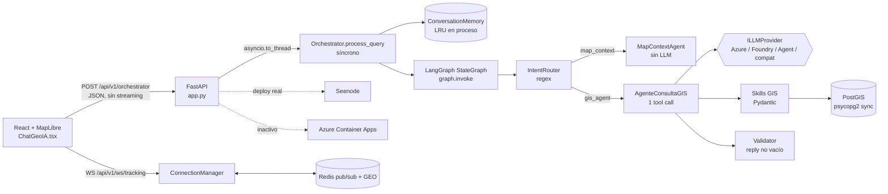
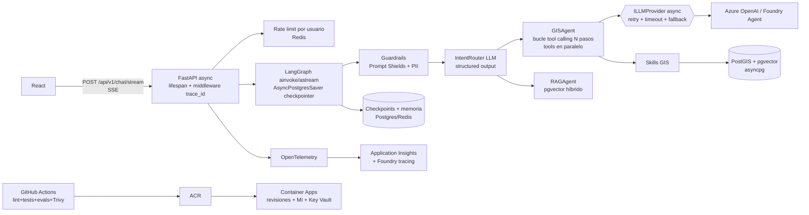

# Roadmap para cerrar brechas

Prioridad: indispensables (R2–R6) primero, deseables (D1, D2) después. Todo reutiliza lo existente (LangGraph, Foundry, PostGIS, Redis, Container Apps, Managed Identity). Nada de reescrituras.

## Arquitectura actual

## Arquitectura objetivo

## Fase 0 — Quick wins (1 semana)

| ID | Requisito | Tarea | Archivos | Terminado cuando | Cómo lo demuestro |
|---|---|---|---|---|---|
| Q1 | R6, F4 | Añadir job `pytest` (+ `pytest-cov`) al workflow de lint | `.github/workflows/ci-cd-lint.yaml`, `requirements-dev.txt` (nuevo) | PR muestra check verde con cobertura | Captura del check y badge en README |
| Q2 | F2, R5 | Middleware `X-Request-ID` + logging JSON con `request_id`, `session_id`, `user` | `app.py`, `src/config/logging.py` (nuevo) | Cada línea de log de una petición comparte `request_id` | Log de una consulta completa filtrado por id |
| Q3 | R5, F2 | Registrar `usage` (prompt/completion tokens) y latencia por llamada LLM en `LLMResponse` | `src/domain/ports/illm_provider.py`, `src/infrastructure/llm/base.py`, `azure_agent.py` | Log `llm.call model=… tokens_in=… tokens_out=… ms=…` | Tabla de costo por consulta |
| Q4 | R4 | `max_length` en `message` (p. ej. 4000) y límite de tamaño de `layersGeojson`; migrar `on_event` a `lifespan` | `src/presentation/schemas.py:152`, `app.py:282` | Test 422 con mensaje gigante | Test |
| Q5 | R4 | Limpiar: singleton duplicado, `direct_action` muerto (implementarlo o borrarlo), `/ready` con `to_thread` | `langgraph_flow.py:151`, `orchestrator.py:129`, `health.py:22` | Tests verdes | Diff pequeño |
| Q6 | F2 | Tests del agente con LLM simulado (`FakeLLMProvider`) | `tests/unit/test_agente_gis.py` (nuevo) | Cubre: respuesta conversacional, tool call válido, args JSON inválidos, skill falla, timeout | Ejecutar pytest en vivo |

## Fase 1 — Indispensables (2–3 semanas)

| ID | Requisito | Tarea | Archivos | Terminado cuando | Cómo lo demuestro |
|---|---|---|---|---|---|
| A1 | R2, R3, F1 | Añadir `achat()` async al puerto usando `AsyncAzureOpenAI`/`AsyncOpenAI` y `asyncio.timeout`; nodos LangGraph `async def`; `graph.ainvoke`; eliminar `to_thread` del endpoint | `illm_provider.py`, `base.py`, `azure_agent.py`, `agents_wrappers.py`, `langgraph_flow.py`, `orchestrator.py` | 0 hilos daemon por request; prueba de carga con 50 usuarios concurrentes sin degradación | Gráfica locust antes/después |
| A2 | F5, R2 | Endpoint SSE `POST /api/v1/chat/stream` con `graph.astream_events` y `stream=True` en la narración | `src/presentation/api/chat_stream.py` (nuevo), `ChatGeoIA.tsx` (front) | Time-to-first-token < 1.5 s medido | Demo del chat escribiendo en vivo |
| A3 | R5, F2 | Bucle de tool calling (máx. N=5 iteraciones) que ejecuta **todos** los `tool_calls`, en paralelo con `asyncio.gather` + `Semaphore` | `agenteConsultaGIS.py` | Test: "filtra X y haz buffer de 500 m" ejecuta 2 skills | Traza con 2 spans de tool |
| A4 | F2, R5 | Memoria persistente: `AsyncPostgresSaver` de LangGraph (checkpointer por `thread_id = user:session`) o Redis; ventana por tokens con `tiktoken` + resumen | `langgraph_flow.py`, `conversation_memory.py` | Reiniciar contenedor no pierde historial; 2 réplicas comparten contexto | Demo: kill del pod y seguir conversando |
| A5 | R5, F5 | Resiliencia: `tenacity` (retry exponencial con jitter sobre 429/5xx respetando `Retry-After`), fallback a deployment secundario | `base.py`, `llm_settings.py` | Test con `respx` simulando 429→200 y 500×3→fallback | Test |
| A6 | F4, R5 | OpenTelemetry: `azure-monitor-opentelemetry` + spans por nodo LangGraph y por tool; tracing de Foundry (`AIProjectClient.telemetry`) | `app.py`, `src/config/telemetry.py` (nuevo) | Transacción end-to-end visible en App Insights con spans `llm.chat` y `tool.buffer_analysis` | Captura del end-to-end transaction |
| A7 | R6, F4 | Reactivar CD en Azure: Bicep para Container Apps + Key Vault + Log Analytics; Trivy en pipeline; entornos `dev`/`prod` con aprobación; rollback por revisión | `infra/main.bicep` (nuevo), `.github/workflows/ci-cd-deploy.yaml` | Push a `developer` despliega a dev; tag despliega a prod tras aprobación; `az containerapp revision activate` documentado | Video del pipeline + revisión anterior reactivada |
| A8 | Seguridad | Rate limiting por usuario (Redis, token bucket) y auditoría de interacción LLM (tabla `ai_audit`) | `src/presentation/middleware/rate_limit.py`, `scripts/migrations/004_ai_audit.sql` | 429 tras N req/min; cada respuesta tiene fila de auditoría | Consulta SQL a `ai_audit` |

## Fase 2 — Deseables y nivel producción (3–4 semanas)

| ID | Requisito | Tarea | Archivos | Terminado cuando | Cómo lo demuestro |
|---|---|---|---|---|---|
| B1 | D1 | IntentRouter con LLM + structured output (Pydantic) y regex como fast-path | `agents_wrappers.py` | Dataset de 50 frases con accuracy ≥ 90% | Reporte de eval |
| B2 | D1, F3 | Human-in-the-loop con `interrupt()` antes de skills costosas o destructivas | `langgraph_flow.py`, endpoint `POST /chat/{thread}/resume` | Flujo pausado y reanudado tras reinicio | Demo |
| B3 | D2 | RAG sobre normativa/manuales técnicos en **pgvector** (ya hay PostGIS): chunking, embeddings Azure OpenAI, búsqueda híbrida (BM25 `tsvector` + vector, RRF) | `src/infrastructure/rag/`, `scripts/migrations/005_pgvector.sql`, skill `search_docs` | Recall@5 ≥ 0.8 en 30 preguntas doradas | Respuesta con citas |
| B4 | Calidad | Evaluación LLM: dataset dorado de selección de tools + `azure-ai-evaluation` (groundedness, relevance) en CI nocturno | `tests/evals/` | Job que falla si tool-accuracy < umbral | Reporte en artefacto CI |
| B5 | Seguridad | Azure AI Content Safety / Prompt Shields antes del LLM; enmascarado de PII (Presidio o regex DNI/teléfono) en logs y memoria | `src/application/guardrails/` | Tests con ataques de inyección conocidos | Tabla de ataques bloqueados |
| B6 | F5 | Pruebas de carga (locust) y SLO: p95 chat < 4 s, TTFT < 1.5 s; escalado KEDA por HTTP concurrency | `tests/load/locustfile.py`, Bicep | Informe p50/p95/p99 | Gráfica |

## Orden recomendado

Q1 → Q2 → Q3 → Q6 → A1 → A3 → A6 → A4 → A2 → A5 → A7 → A8 → B1 → B3 → B4 → B5 → B2 → B6.
