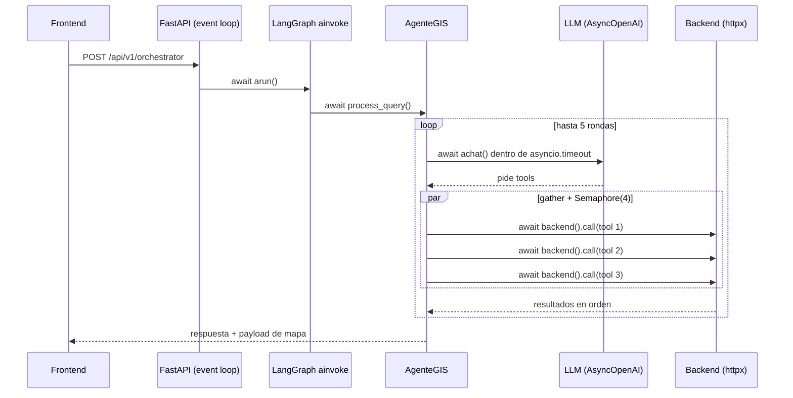
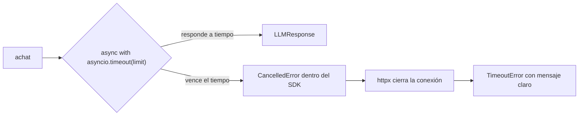
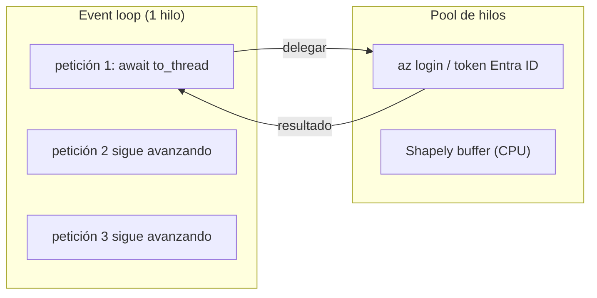
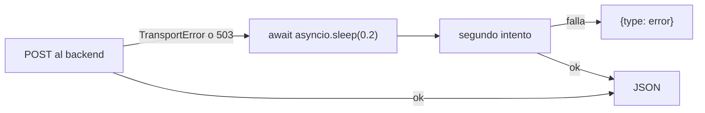
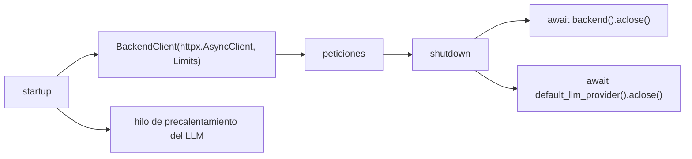

# Diagramas de uso de asyncio

## 1. Visión general de una petición



## 2. `asyncio.gather` + `asyncio.Semaphore`

El modelo pide 6 tools. Como máximo 4 corren a la vez; las otras esperan un hueco. `gather` devuelve los resultados **en el mismo orden** en que se pidieron.

```mermaid
gantt
    dateFormat X
    axisFormat %L ms
    section hueco 1
    tool 1 :0, 300
    tool 5 :300, 500
    section hueco 2
    tool 2 :0, 200
    tool 6 :200, 450
    section hueco 3
    tool 3 :0, 250
    section hueco 4
    tool 4 :0, 150
```



Total ≈ 500 ms en vez de la suma (≈ 1 600 ms).

```python
semaphore = asyncio.Semaphore(MAX_PARALLEL_TOOLS)

async def _bounded(call):
    async with semaphore:          # espera si ya hay 4 dentro
        return await self._run_tool(call, context)

return list(await asyncio.gather(*(_bounded(tc) for tc in tool_calls)))
```

`_run_tool` nunca lanza excepciones (las convierte en `{"type": "error", ...}`), así que un fallo no tumba al resto.

## 3. `asyncio.timeout` (cancelación real)



## 4. `asyncio.to_thread` (no bloquear el loop)



Si se llamara a esas funciones directamente en una corrutina, **todas** las peticiones quedarían congeladas mientras tanto.

## 5. `asyncio.sleep` en el reintento al backend



`asyncio.sleep` cede el control; `time.sleep` bloquearía todo el servicio.

## 6. Ciclo de vida de los clientes


